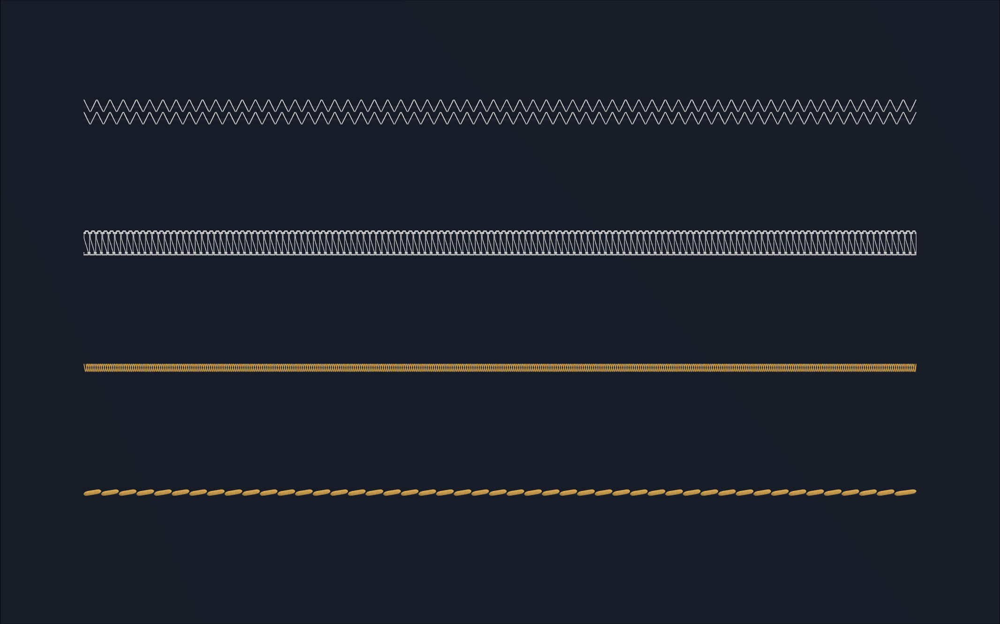

I've been working on getting OpenAI's Astra to operate [CLO 3D](https://www.clo3d.com/en), a fashion design tool. CLO is a bespoke CAD program tailored for fashion. It allows a designer to simulate a garment on an avatar starting from 2D fabric panels. I wanted to know whether, given an image as input, AI could drive CLO to automate the garment construction ([patternmaking](https://en.wikipedia.org/wiki/Pattern_(sewing))) process.

Here's a demo!

<iframe style="width: 100%; aspect-ratio: 16 / 9; border: 0" src="https://www.youtube-nocookie.com/embed/l-vsazlKP_0" title="AI fashion demo" allow="encrypted-media; picture-in-picture; fullscreen" loading="lazy"></iframe>

[*More demos below*](#demos)

## Patternmaking

AI has enabled us to design almost anything we can describe, but that expressibility is still confined to the digital world, ie images. I'm motivated by transferring that freedom of expression to the physical world. Let's live in a world where whatever you can imagine, you can create.

And there's a lot to creating a physically realistic garment. You need to know how to model hardware like buttons and zippers, choose the right fabric by its properties like material, weight and weave. Model the physical construction: linings, pleats, collars, pockets and get the fit right with darts, gathers and cinches. The list goes on. Here's a sample of what I've explored in automating the patternmaking process

{: .image-grid .cols-2 .uniform}
*Folding a collar*

{: style="object-position: center 60%"}

{: .image-grid .cols-2 .uniform}
*Fitting fabric around curved parts of the body with darts*

{: style="object-fit: contain; background: #c8c8c8"}
{: style="object-fit: contain"}
{: .image-grid .cols-2 .uniform}

*Pleats to create folds in the fabric*

{: style="object-fit: contain; background: #c8c8c8"}
{: style="object-fit: contain"}
{: .image-grid .cols-2 .uniform}

*Quilting*

{: .image-grid}

*Various kinds of top-stitches*

## Designing the Software

Complex visual reasoning is still hard for models, even today, but there was certainly a pre-Astra and post-Astra step function in understanding. Pre-Astra my process was workflow centric, and I redesigned the from scratch post-Astra to be much more model-centric.

The workflow centric version began when I found that ChatGPT-image-1 was pretty good at creating design drawings from an in-the-wild image of someone wearing a garment. I would take these images, turn them into SVGs (using [QuiverAI](https://quiver.ai/)), calculate various geometric properties and cross-my-fingers hoping the model could take all this context and know which edges to sew together. When Astra came out, I was able to take a more model-centric approach. Designing for Astra felt more like creating a team of agents that would collaboratively script CLO3D as an environment. I relied heavily on custom tools, elaborate multimodal documentation that could be retrieved by the model, and feedback through CLO3D screenshots and tool call responses. I tried to mimimize computer use only because it's currently slow and error prone, but eventually I'm sure that'll be a thing of the past.

## Demos

<iframe style="width: 100%; aspect-ratio: 16 / 9; border: 0" src="https://www.youtube-nocookie.com/embed/68FDjW0DUWM" title="AI fashion demo" allow="encrypted-media; picture-in-picture; fullscreen" loading="lazy"></iframe>

<iframe style="width: 100%; aspect-ratio: 16 / 9; border: 0" src="https://www.youtube-nocookie.com/embed/ZoUJxx7wiic" title="AI fashion demo" allow="encrypted-media; picture-in-picture; fullscreen" loading="lazy"></iframe>

<iframe style="width: 100%; aspect-ratio: 16 / 9; border: 0" src="https://www.youtube-nocookie.com/embed/xA98yEFPxSM" title="AI fashion demo" allow="encrypted-media; picture-in-picture; fullscreen" loading="lazy"></iframe>

<iframe style="width: 100%; aspect-ratio: 16 / 9; border: 0" src="https://www.youtube-nocookie.com/embed/neAaqX4VBEw" title="AI fashion demo" allow="encrypted-media; picture-in-picture; fullscreen" loading="lazy"></iframe>

