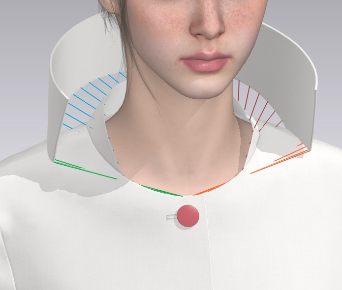
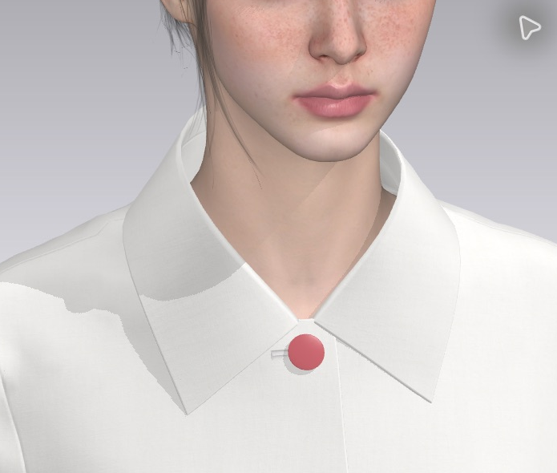
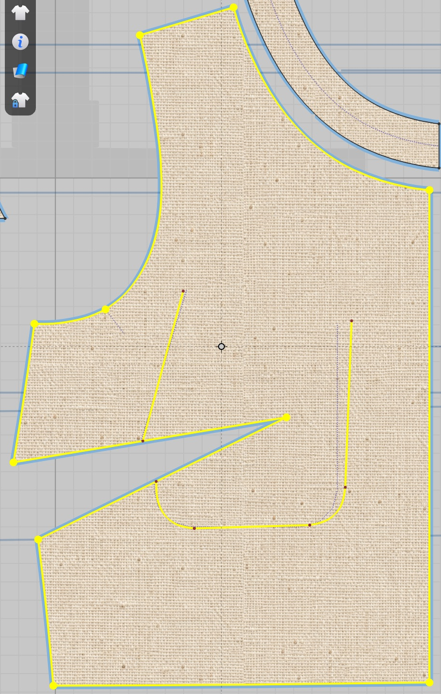
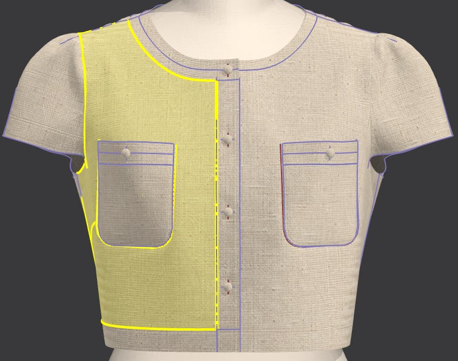
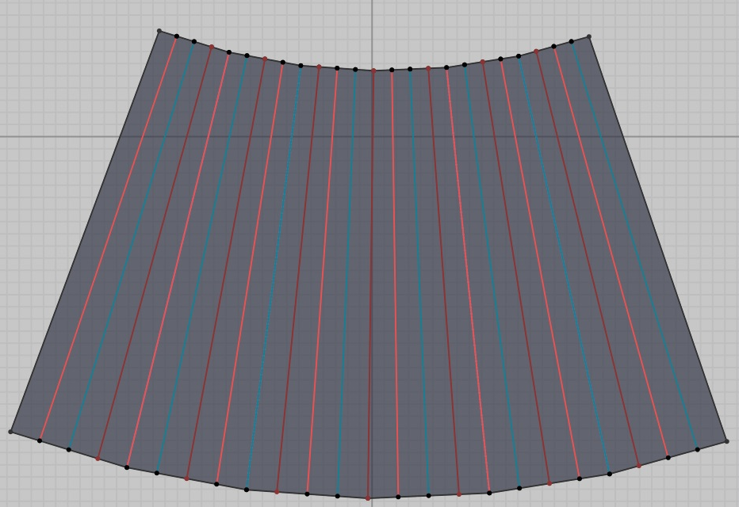
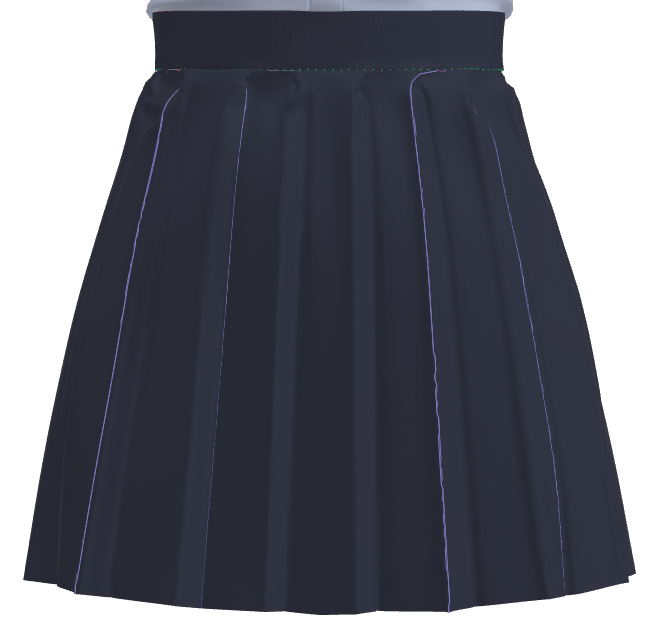
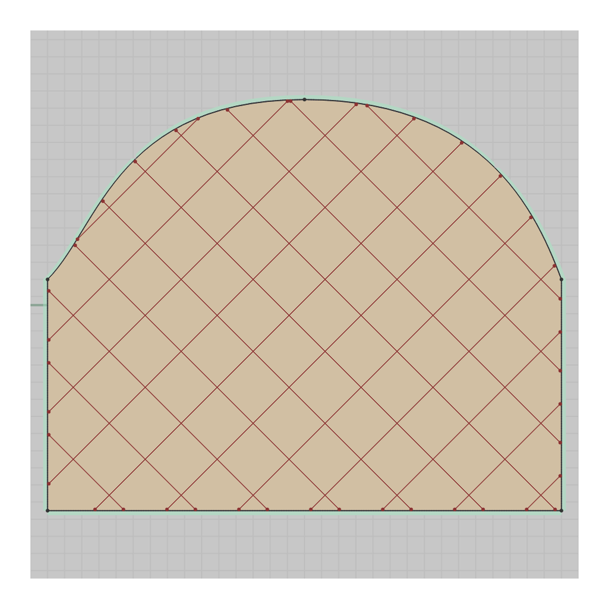
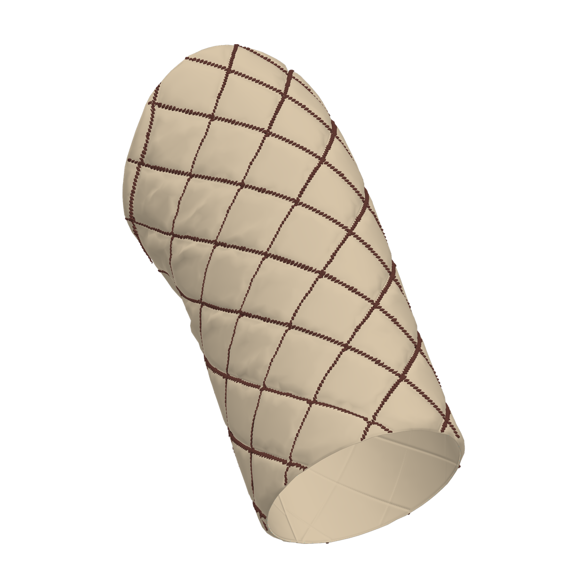

I've been teaching OpenAI's Astra to operate [CLO 3D](https://www.clo3d.com/en), a CAD program built for fashion. Designers use it to stitch 2D fabric panels together and simulate the resulting garment on an avatar. I wanted to know whether AI could take a single image of a garment and drive CLO through the whole construction process, known as [patternmaking](https://en.wikipedia.org/wiki/Pattern_(sewing)).

Here's a demo!

<iframe style="width: 100%; aspect-ratio: 16 / 9; border: 0" src="https://www.youtube-nocookie.com/embed/l-vsazlKP_0" title="AI fashion demo" allow="encrypted-media; picture-in-picture; fullscreen" loading="lazy"></iframe>
*Pleated skirt. Collared buttoned blouse with gathered sleeves.*

[*More demos below*](#demos)

## Patternmaking

AI lets us design almost anything we can describe, but that freedom is still confined to the digital world. I want to carry it into the physical world, where whatever you can imagine, you can make.

There's a lot to creating a real garment. You need to know how to model hardware like buttons and zippers, and how to choose the right fabric by its material, weight and weave. Model the physical construction: linings, pleats, collars, pockets. Get the fit right with darts, gathers and cinches. The list goes on. Here's a sample of what I've explored thus far:

{: .image-grid .cols-2 .uniform}

*Folding a collar*

{: style="object-position: center 60%"}

{: .image-grid .cols-2 .uniform}

*Fitting fabric around curved parts of the body with darts*

{: style="object-fit: contain; background: #c8c8c8"}
{: style="object-fit: contain"}
{: .image-grid .cols-2 .uniform}

*Pleats to create folds in the fabric*

{: style="object-fit: contain; background: #c8c8c8"}
{: style="object-fit: contain"}
{: .image-grid .cols-2 .uniform}

*Quilting*

## Designing the Software

Complex visual reasoning is still hard for models, even today, but the release of Astra marked a step change. Pre-Astra my process was workflow centric, and I redesigned from scratch post-Astra to be model-centric.

The workflow centric version began when I found that ChatGPT-image-1 was pretty good at generating design drawings from in-the-wild images of someone wearing a garment. I would take these design drawings, convert them to SVG (using [QuiverAI](https://quiver.ai/)), calculate various geometric properties and cross my fingers, hoping the model could take all this context and know which edges to sew together.

Designing for Astra felt like creating a team of agents that would collaboratively script CLO as an environment. I relied heavily on custom tools, elaborate multimodal documentation that the model could retrieve, and feedback through CLO screenshots and tool call responses.

I tried to minimize computer use only because it's currently slow and error-prone, but eventually I'm sure that'll be a thing of the past.

## Demos

<iframe style="width: 100%; aspect-ratio: 16 / 9; border: 0" src="https://www.youtube-nocookie.com/embed/68FDjW0DUWM" title="AI fashion demo" allow="encrypted-media; picture-in-picture; fullscreen" loading="lazy"></iframe>
*Patch dress with collar*

<iframe style="width: 100%; aspect-ratio: 16 / 9; border: 0" src="https://www.youtube-nocookie.com/embed/ZoUJxx7wiic" title="AI fashion demo" allow="encrypted-media; picture-in-picture; fullscreen" loading="lazy"></iframe>
*Corporate outfit with buckle*

<iframe style="width: 100%; aspect-ratio: 16 / 9; border: 0" src="https://www.youtube-nocookie.com/embed/xA98yEFPxSM" title="AI fashion demo" allow="encrypted-media; picture-in-picture; fullscreen" loading="lazy"></iframe>
*Black and white dress*

<iframe style="width: 100%; aspect-ratio: 16 / 9; border: 0" src="https://www.youtube-nocookie.com/embed/neAaqX4VBEw" title="AI fashion demo" allow="encrypted-media; picture-in-picture; fullscreen" loading="lazy"></iframe>

