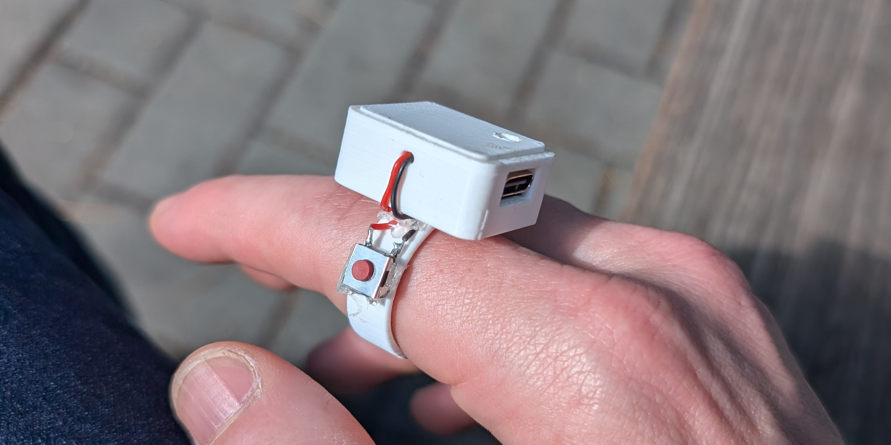

Software is dead, so let's build some hardware.

A ring enclosure with esp32 board, mic, battery and pushbutton to be exact.

I wanted to go on long walks with a ring device I could speak into that would organize my thoughts and perform agentic tasks. It got pretty good at operating my phone for agentic tasks too. At one point, I could develop features for the ring itself by talking to it (it could control a remote instance of Claude Code with access to the ring's codebase).

Here are some videos:

<iframe style="width: 100%; aspect-ratio: 16 / 9; border: 0" src="https://www.youtube-nocookie.com/embed/Uaij7E2jSdc" title="Ponder demo" allow="encrypted-media; picture-in-picture; fullscreen" loading="lazy"></iframe>
*Agentic phone use - ordering an Uber*

<iframe style="width: 100%; aspect-ratio: 16 / 9; border: 0" src="https://www.youtube-nocookie.com/embed/KwGzgHKa8jI" title="Ponder demo" allow="encrypted-media; picture-in-picture; fullscreen" loading="lazy"></iframe>
*Background execution on the phone*

<iframe style="width: 100%; aspect-ratio: 16 / 9; border: 0" src="https://www.youtube-nocookie.com/embed/cFswDVgzemI" title="Ponder demo" allow="encrypted-media; picture-in-picture; fullscreen" loading="lazy"></iframe>
*Feature development for the ring by using the ring*